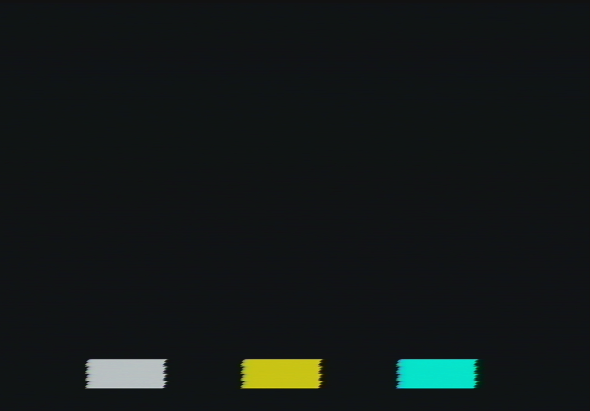
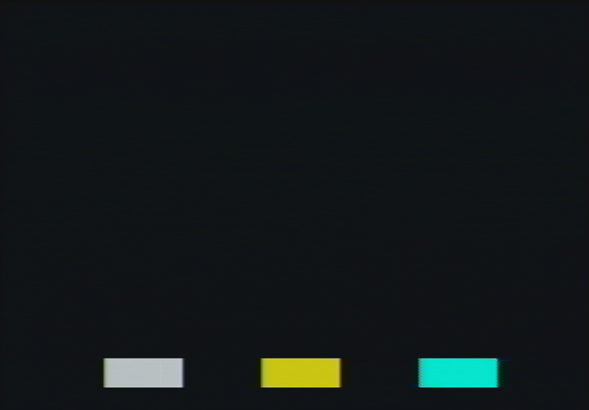

# Sharp MZ - Raster Under Question / HBlank Binary Search

Currently only for the Sharp MZ-800 in MZ-800 graphics mode, but I'll add support for other Sharp MZ platforms soon.

The Atari ST scene calls this Raster Under Question, but I think HBlank Binary Search is a more descriptive name. It syncs the CPU to the screen to within about 1 T-state (5 pixels in 640-dot mode, 2.5 pixels in 320-dot mode), which is useful for precisely timed effects on screen.

If the CKSW bit is off, a scanline is not a whole number of CPU cycles (227.2 T), so the edges of a border effect wobble a little.

If the CKSW bit is on, a scanline is a whole number of CPU cycles (224 T), so the border effect is rock solid.

